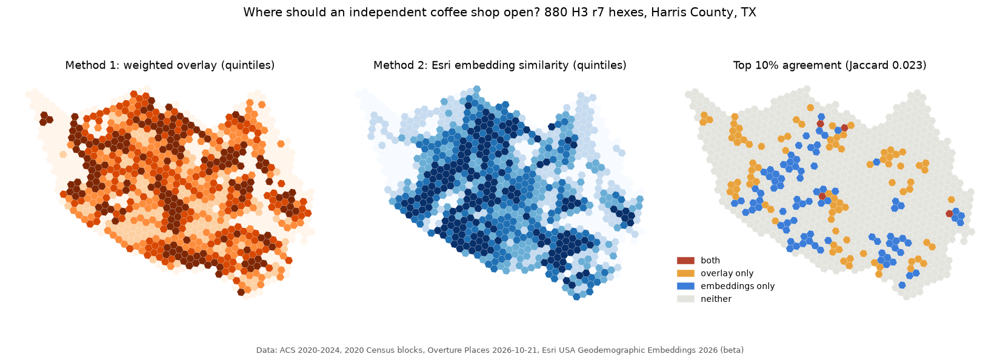
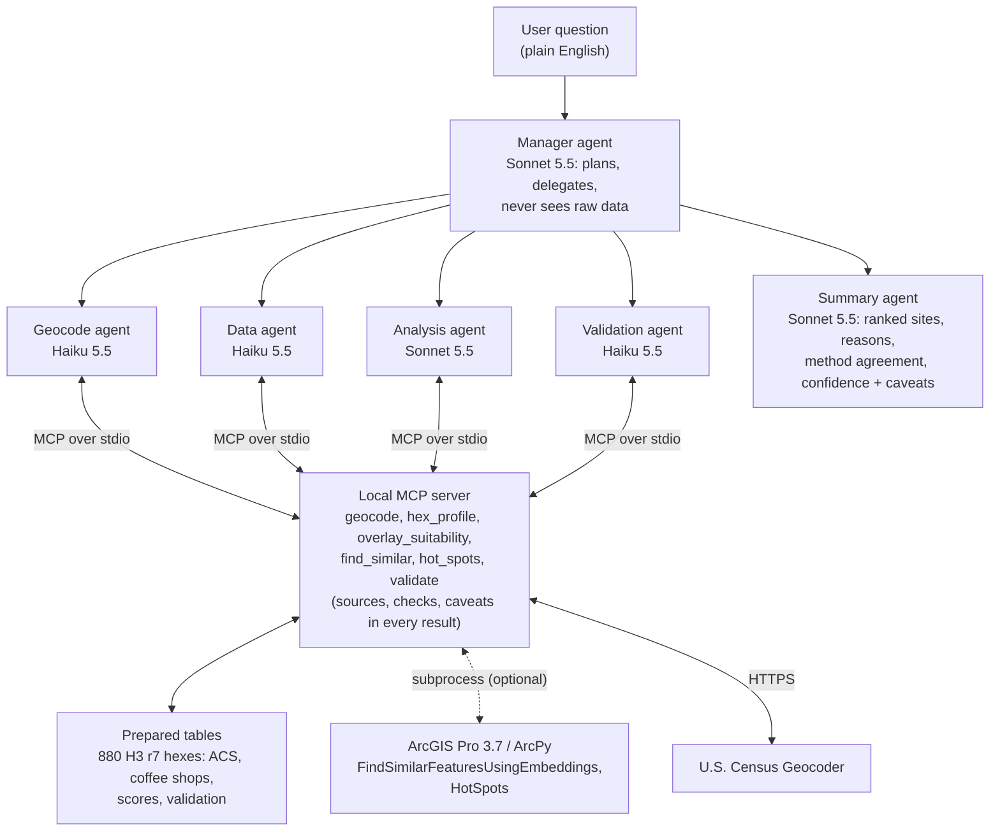

# agentic-site-selection

**agentic-site-selection** asks, in plain English, *"Where in Houston should an independent coffee shop open next?"* A manager agent plans the work and hands it to small subagents, which call a local [Model Context Protocol](https://modelcontextprotocol.io) server. The server does the spatial math with ArcGIS Pro and numpy over a prepared hex table. A summary agent then writes a ranked answer with its reasons, says whether the two methods agree, and adds a confidence and caveats block. The two methods are an expert-weighted overlay and Esri's **USA Geodemographic Embeddings** with **Find Similar Features Using Embeddings**. Both are scored against coffee shops that were hidden from them.





## Results (Harris County, Texas; built 22 Oct 2026)

**Study area.** Harris County is covered by 880 H3 resolution-7 hexes (about 5.2 km² each). Overture Places lists 1,217 coffee shops in them after cleaning. 509 of these are chains and 708 are independents, and the independents sit in **253 hexes**. Population is the ACS 2020-2024 count, 4,838,303, allocated from 1,115 tracts to hexes by 2020 block populations. Esri's own hex population field gives 4,973,340, and the two agree with Pearson r = 0.971 per hex.

**Validation: spatially blocked hold-out.** The hexes were split into 5 blocks (k-means on hex centroids). For each block, all of its shops were hidden. The embedding query was rebuilt from the independent-shop hexes in the other four blocks, and the overlay's competition term was recomputed without the hidden shops. Each method was then scored on how highly it ranks the block's real independent-shop hexes. Values are means across blocks with the min-max range in brackets ([`results/validation.json`](results/validation.json), per block in [`results/validation_blocks.csv`](results/validation_blocks.csv)):

| Method | AUC (shop vs non-shop hexes) | P@k (k = held-out shop hexes) | P@10 |
|---|---|---|---|
| Overlay, expert weights | 0.708 (0.550-0.810) | 0.427 (0.273-0.703) | 0.40 (0.10-1.00) |
| Overlay, demand only (competition weight 0) | 0.707 (0.549-0.812) | 0.429 (0.273-0.683) | 0.40 (0.10-1.00) |
| Embeddings, Esri *Find Similar Features Using Embeddings* | **0.743** (0.528-0.886) | **0.484** (0.318-0.629) | **0.58** (0.40-0.80) |
| Embeddings, numpy cosine (open fallback) | 0.743 (0.528-0.886) | 0.484 (0.318-0.629) | 0.58 (0.40-0.80) |
| Random ordering (2,000 per block) | 0.500 | 0.285 | 0.286 |

* **Both methods beat random on average, and the embeddings did better in 4 of 5 blocks.** In the north, northeast, west and southeast blocks, the embedding AUC was 0.70-0.89 against 0.55-0.81 for the overlay.
* **The urban core reverses that.** The central block (Downtown to the Galleria) holds 444 of the 708 independents. There the embeddings were close to random (AUC 0.528, P@10 0.40) and the overlay did well (AUC 0.744, P@10 1.00). With that block hidden, the query is built only from suburban shop hexes, so it describes suburbs. The method finds "more of what you showed it", and it is only as good as the query.
* **Inside a held-out block the competition term barely matters.** Hiding the block's shops makes the term nearly constant there, so the two overlay rows are almost identical. The test therefore measures the demand criteria, not the competition penalty.

**Esri tool vs the open re-implementation.** `arcpy.geoai.FindSimilarFeaturesUsingEmbeddings` reports that it builds one query embedding from the query features. Cosine similarity to the **mean** of the query vectors, written in numpy, reproduces it exactly: Spearman rank correlation **1.000000**, maximum absolute score difference 1.6 × 10⁻⁷, identical top 10% over all 880 hexes ([`results/summary.json`](results/summary.json)). Two other variants match less well: the mean of unit vectors (ρ = 0.987) and the best single-query match (ρ = 0.663). The numpy Gi* also matches `arcpy.stats.HotSpots` (contiguity edges and corners) exactly (ρ = 1.0, max |Δz| = 0.0).

**The two methods disagree.** Their top-10% sets share 4 of 88 hexes (**Jaccard 0.023**). Over the hexes the overlay does not mask, their scores are uncorrelated (Spearman 0.035). The overlay favours high-income, younger hexes with few shops nearby, such as the area near Humble and Atascocita in the northeast (best hex 9.03/10). The embeddings favour middle-income suburbs that already look like shop areas, such as Katy, Cypress and Clear Lake (best similarity 0.936). One method asks "where are the gaps?" and the other asks "where looks like a coffee neighbourhood?". Neither answers "where will a shop make money?".

**Agent runs.** There are five saved questions with full JSON transcripts in [`results/agent_runs/`](results/agent_runs). Each run makes 7-10 model calls and 3-5 MCP tool calls, takes 41-50 s, and costs **$0.07-0.16** (**$0.585 in total**: 183k input tokens, 153k of them cache writes; 30k output). Question 5 asks for monthly revenue and a specific storefront. The system answers that the data cannot do this, and it reports what the hex can tell you instead.

| # | Question (abridged) | Cost | Outcome |
|---|---|---|---|
| 1 | Where should an independent coffee shop open next? Top 5 | $0.110 | Overlay top 5 (northeast cluster near -95.21, 29.95); states that the methods disagree; confidence low |
| 2 | Is 2700 White Oak Dr (Heights) a good bet? | $0.066 | Strong demand but 85 shops in the hex and its neighbours; "overlay only" top 10%; cannot judge the storefront |
| 3 | Weight ages 25-34 most, competition less | $0.111 | Agent re-weights the overlay (0.40 / 0.10 competition); inner-loop hexes rise, and the top 10 shares no hex with the embeddings |
| 4 | Places like where independents thrive, with none yet | $0.161 | `find_similar` with existing-shop hexes excluded, cross-checked with the overlay; leads with two hexes that both rank well and have no coffee shop (north near -95.38, 30.05 and east near -94.99, 29.76) |
| 5 | Monthly revenue at 1500 McKinney St, and which storefront to lease? | $0.137 | **Declines**: no sales, rent or parcel data and 5 km² hexes; gives the hex's demand and saturation |

The static page in [`docs/`](docs/index.html) shows both score maps, the agreement map, the validation table and all five runs. It is plain HTML and MapLibre with no API keys, and visitors' views cost nothing.

## What needs ArcGIS and what runs open

| Part | Needs | Without it |
|---|---|---|
| Copy the study-area hexes of USA Geodemographic Embeddings 2026 to a local file GDB (`pipeline/arcpy_tools.py export`) | ArcGIS Pro signed in to an **ArcGIS organizational account**: the layer is subscriber content ("Token Required") | Not possible; use the committed derived scores |
| `FindSimilarFeaturesUsingEmbeddings` (`arcpy_tools.py similar`, `find_similar(engine="arcpy")`) | ArcGIS Pro 3.7 **Advanced** (GeoAI toolbox) | numpy cosine on the local vectors (identical ranking) |
| Hot Spot Analysis cross-check (`arcpy_tools.py hotspots`) | ArcGIS Pro, any license level | numpy Gi* (identical) |
| ACS fields, coffee shops, overlay, validation, MCP server, agents, web page | Python only (`environment.yml`) | n/a |
| `find_similar` for a custom query with no embeddings on disk | n/a | **open proxy**: cosine on z-scored ACS and shop features, clearly labelled as *not* the embedding method |

No ArcGIS Online credits are used. Nothing is hosted, and there is no Enrich, online geocoding or routing. The embeddings are read once through ArcGIS Pro's sign-in and kept in `data/esri/` (git-ignored).

## Run it

```bash
conda env create -f environment.yml && conda activate agentic-site-selection
python pipeline/fetch_open_data.py          # ACS summary files, 2020 block populations, county boundary, Overture Places (DuckDB over S3)
python pipeline/build_hexes.py              # data/hexes_open.parquet (GeoParquet, no embeddings) + data/shops.parquet
"C:/Program Files/ArcGIS/Pro/bin/Python/envs/arcgispro-py3/python.exe" pipeline/arcpy_tools.py export   # optional, ArcGIS org sign-in
python pipeline/run_methods.py              # results/hex_scores.csv, results/summary.json, docs/data/hexes.geojson
python pipeline/validate.py                 # results/validation*.{json,csv}  (--no-esri for the open path)
pytest                                      # offline tests, including the MCP server over stdio
python -m agents.run_agents --only 1        # live agent run; needs an Anthropic API key (see agents/run_agents.py)
python docs/build_docs_data.py && python docs/make_hero.py
```

Register the server with Claude Code: `claude mcp add site-selection -- /path/to/env/python -m mcp_server.server`.

## Method notes

**Hexes and census fields.** Hexes are the H3 r7 cells that overlap Harris County, using the same IDs as Esri's layer, so the two join exactly. ACS 5-year tables B01001, B01003 and B19013 come from the Census Bureau's table-based summary files, because the `api.census.gov` endpoint now answers "Missing Key". Tract counts go to hexes **dasymetrically**: each 2020 block (POP100 from TIGERweb) is placed in the hex holding its internal point, and a tract's count is split in proportion to its 2020 block population in each hex. Plain area weighting would put people in the Ship Channel, parks and reservoirs. Median income cannot be split this way, so each hex gets the population-weighted mean of its tracts' medians. This is an approximation, not a median. Density is allocated population divided by block land area, capped at the hex's in-county area.

**Coffee shops.** These are Overture Places release 2026-10-21.0, categories `coffee_shop`, `cafe` and `coffee_roastery`. The cleaning steps:
* Drop records with confidence under 0.5 or tagged permanently closed.
* Drop internet cafés and tea, boba, juice and donut-first names.
* De-duplicate records with the same name within 75 m.

A shop counts as a **chain** if its brand or name matches a list of national and regional chains, or if its name appears at 4 or more sites. Everything else is **independent**. The rules are in [`config/study_area.yaml`](config/study_area.yaml).

**Method 1, overlay** ([`config/overlay.yaml`](config/overlay.yaml)). Each criterion is rescaled to 1-10 between its 5th and 95th percentile, then the scores are combined as a weighted sum:

| Criterion | Rescale | Weight |
|---|---|---|
| Population density | log, increasing | 0.30 |
| Share aged 25-34 | linear, increasing | 0.25 |
| Median household income | linear, increasing | 0.20 |
| Coffee shops in the hex and its 6 neighbours | linear, decreasing | 0.25 |

Hexes with fewer than 500 residents or less than 1 km² of land get the minimum score of 1 (230 hexes). The functions mirror ArcGIS *Rescale by Function* (linear, logarithmic) and are applied to the hex table in numpy.

**Method 2, embeddings.** The query features are all 253 hexes that hold an independent shop; Overture has no ratings, so "top-rated" was not possible. The tool is `FindSimilarFeaturesUsingEmbeddings` with threshold 0, so every hex is scored.

## Caveats

* **No sales data.** Every result means "like where shops are" or "where the expert weights say demand is". None of it measures profit or survival, and the validation positives are shops that exist, not shops that succeed.
* **Hexes of about 5 km² are coarse for a coffee shop.** A shop lives or dies on one block's foot traffic, parking and visibility. Read the outputs as areas to scout, not sites.
* **The embeddings are a beta dataset** (USA Geodemographic Embeddings 2026, V2 Beta view). Esri may change them, and their inputs probably include ACS variables like those in the overlay, so the two methods are not fully independent.
* **Overture and OSM completeness.** New openings, closures, pop-ups and independents with little web presence can be missing. Chain tagging is rule-based, and a few multi-site Houston roasters may land on either side.
* **Spatial validation is thin.** There are only 5 blocks, the range across them is wide, and the urban core behaves differently from the suburbs.
* **No multiple-testing correction** is applied to the Gi* hot spots.
* **The agents can still be wrong.** Every tool result carries sources, checks and caveats, and the transcripts are saved so any number can be traced back to a tool call.

## Licensing and data handling

The raw 256-dimension embedding values and every Esri file stay in git-ignored `data/`. They are used under the Esri Master License Agreement. Only scripts, configs, derived scores and metrics, figures, run transcripts and the docs page are committed. [`scripts/check_no_embeddings.py`](scripts/check_no_embeddings.py) runs as a pre-commit hook and blocks any per-dimension embedding column, any `Embedding` column header, any long float vector, and any binary data file.

## Credits

This project was inspired by the GeoAI and agentic-workflow talks at the **Esri Energy Resources GIS Conference 2026** (Houston, May 2026). Several of their practices are built in:
* Esri tools do the math and the language model reasons.
* Agents query a prepared database, not raw data.
* Small models do narrow jobs.
* Answers are measured against held-out reality.
* Every answer comes with a confidence report.

Location embeddings: Esri, *USA Geodemographic Embeddings 2026* (beta), ArcGIS Living Atlas of the World, used under the Esri Master License Agreement. Only derived similarity scores are published.

## Data licenses and attribution

| Data | License / terms | Attribution |
|---|---|---|
| ACS 2020-2024 5-year, 2020 Census blocks (TIGERweb), cartographic boundaries, Census Geocoder | Public domain, U.S. Census Bureau | "Source: U.S. Census Bureau" |
| Overture Maps Places 2026-10-21.0 | [CDLA Permissive 2.0](https://cdla.dev/permissive-2-0/) (Places theme) | "© Overture Maps Foundation" and its listed sources |
| USA Geodemographic Embeddings 2026 (beta) | Esri Master License Agreement; subscriber content | "Esri, USA Geodemographic Embeddings 2026" |
| H3 grid | Apache 2.0 (Uber H3) | n/a |
| Web basemap | [OpenFreeMap](https://openfreemap.org), OpenMapTiles, OpenStreetMap (ODbL) | "© OpenMapTiles © OpenStreetMap contributors" |

## Project layout

```
config/          study_area.yaml (sources, chain rules), overlay.yaml (criteria, functions, weights)
pipeline/        fetch_open_data.py, build_hexes.py, arcpy_tools.py (ArcPy: export, similar, hotspots),
                 run_methods.py, validate.py
sitesel/core.py  overlay, cosine similarity, Gi*, AUC / precision@k (pure numpy)
mcp_server/      server.py (MCP surface, timeouts, errors), tools.py (provenance, checks, caveats, fallbacks)
agents/          run_agents.py: manager + geocode/data/analysis/validation subagents + summary agent, spend ledger
results/         hex_scores.csv, summary.json, validation*.json/csv, agent_runs/*.json (transcripts, ledger)
docs/            index.html (MapLibre page), data/, hero.png, build_docs_data.py, make_hero.py
scripts/         check_no_embeddings.py (licensing guard, pre-commit)
tests/           offline unit tests + MCP stdio test
```

## License

Code: [MIT](LICENSE) © 2026 Landon Melesky. The data keeps its own licenses (see above).
